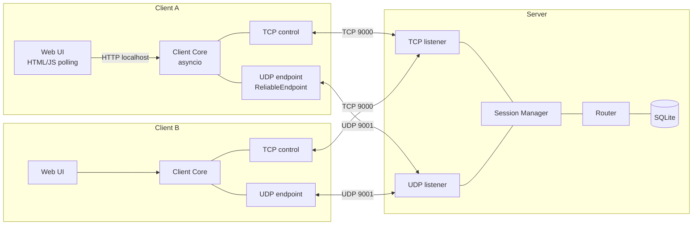
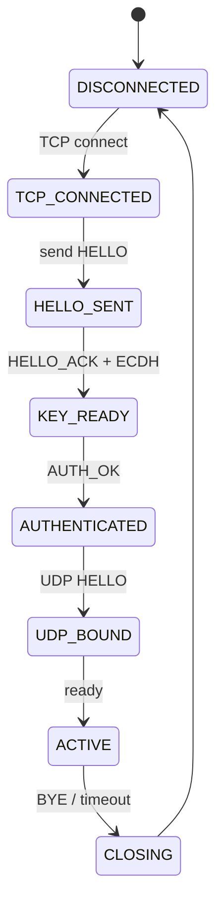
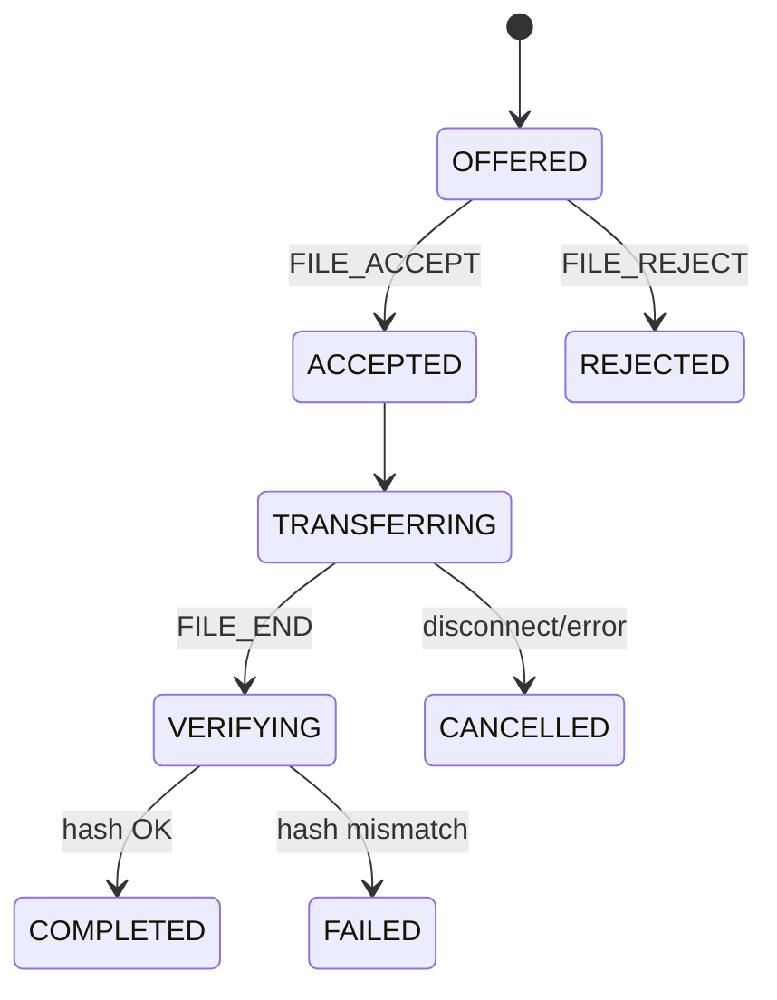
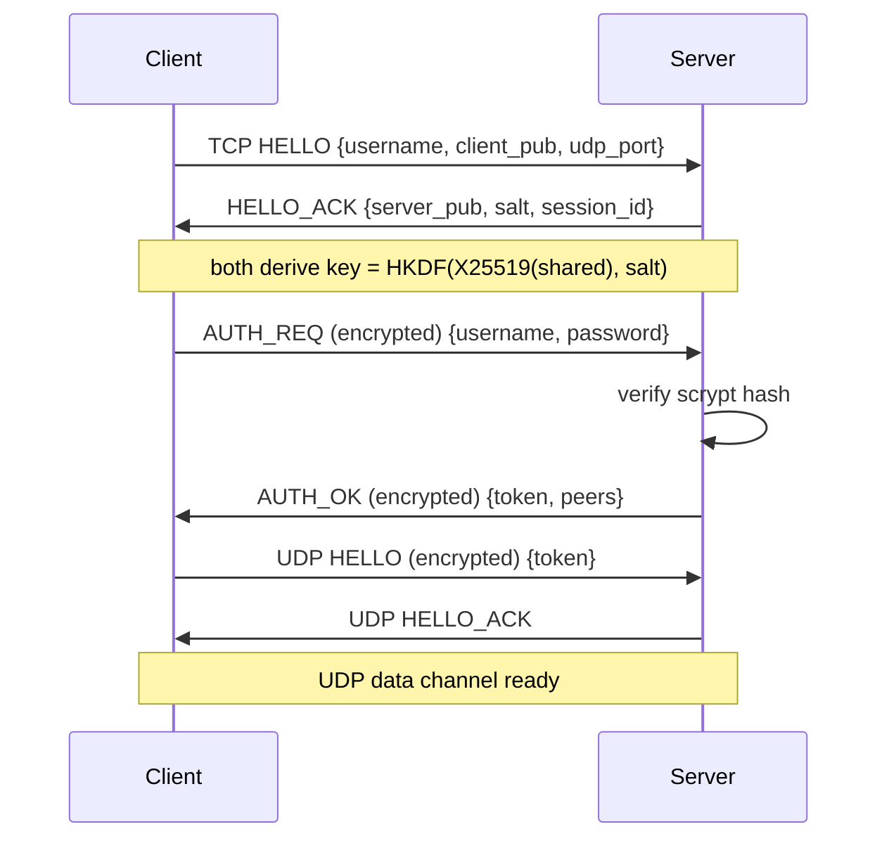
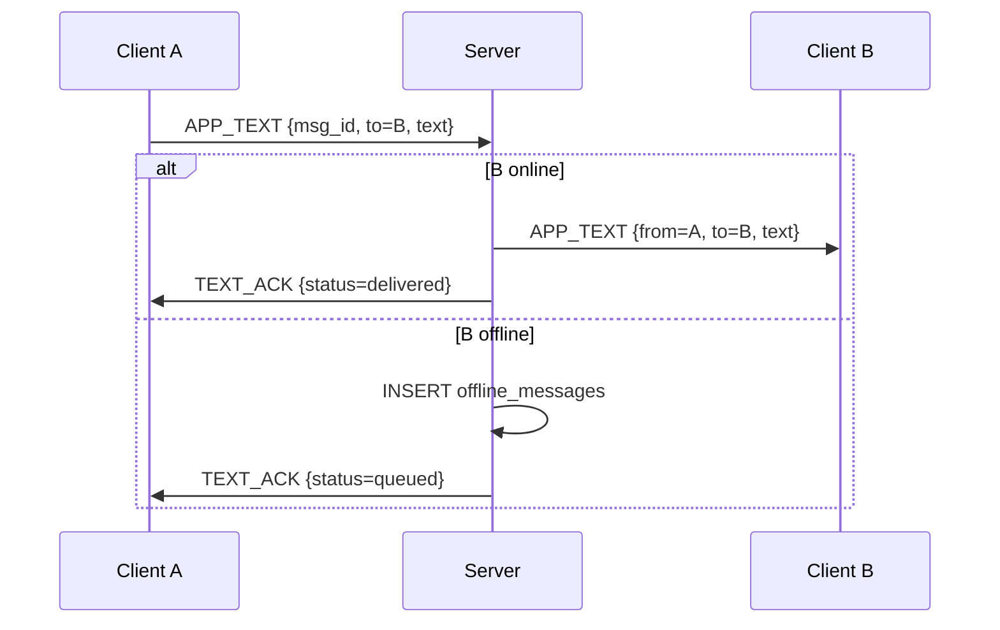
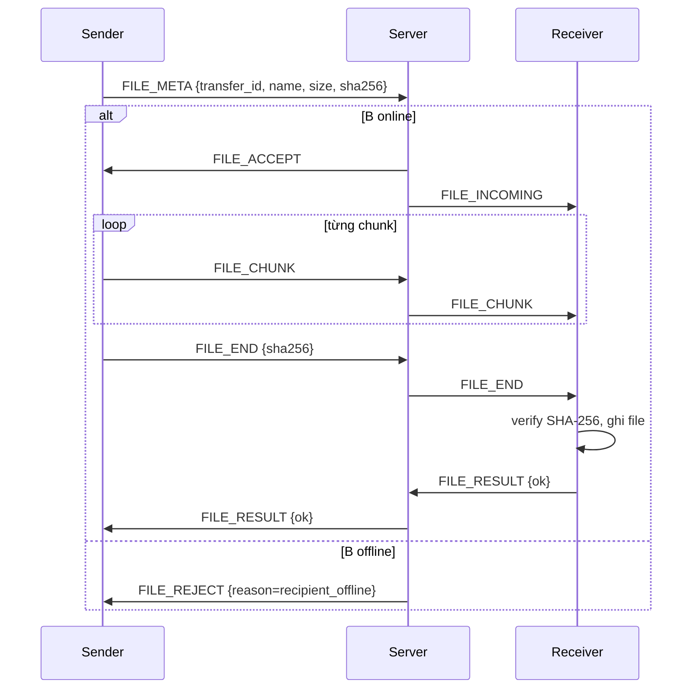

# Ý tưởng & Kiến trúc hệ thống

**Đề tài:** Distributed Streaming-based Client-Server Collaboration Application

**Môn:** Network Application Development

**Phiên bản:** 1.0

---

## 1. Tóm tắt ý tưởng

Xây dựng một ứng dụng cộng tác nhẹ, tự host (self-hosted), hoạt động trong mạng LAN hoặc VPN mà không phụ thuộc dịch vụ cloud bên ngoài. Người dùng đăng nhập, thấy danh sách peer đang online, trao đổi tin nhắn broadcast/unicast, gửi file và nhận lại tin nhắn offline khi đăng nhập lại.

Điểm cốt lõi của đề tài là **tự thiết kế application-layer protocol trên UDP** có:

- Đóng gói header nhị phân cố định.
- Sequence number, sliding window, ACK/SACK, retransmission.
- Congestion control và flow control.
- Nhiều stream độc lập để tránh Head-of-Line (HoL) blocking.
- Mã hoá payload bằng AES-256-GCM.

TCP được dùng cho control plane (handshake, auth, presence, heartbeat). UDP được dùng cho data plane (chat, file chunk) theo đúng tinh thần "UDP STREAMING" của đề.

---

## 2. Mục tiêu và phạm vi

### 2.1 Trong phạm vi

- 10–20 client đồng thời trên localhost/LAN.
- Đăng nhập bằng username/password.
- Presence: danh sách user online, cập nhật khi join/leave.
- Chat broadcast toàn mạng và unicast.
- Gửi file tối đa 100MB, có kiểm tra SHA-256.
- Offline message queue cho tin nhắn text unicast.
- Heartbeat, timeout, graceful disconnect, reconnect thủ công.
- Mã hoá payload TCP/UDP bằng session key.
- HTTP UI + JavaScript thuần, polling (không WebSocket).

### 2.2 Ngoài phạm vi

- P2P thật, NAT traversal, multi-server/federation.
- Voice/video call.
- End-to-end encryption giữa hai client (server relay thấy plaintext).
- Offline file queue (file gửi cho user offline bị từ chối).
- Public internet deployment, PKI, chống MITM tuyệt đối.

---

## 3. Cách diễn giải đề bài

Đề có hai điểm chưa nhất quán:

1. Tiêu đề và mục tiêu yêu cầu protocol trên **UDP streaming**.
2. Rubric Step 2 yêu cầu **TCP handshake**, mục Techniques lại ghi TCP cho file/message và UDP cho heartbeat/discovery.

Cách xử lý: dùng kiến trúc **hybrid**:

| Plane | Transport | Nội dung |
|---|---|---|
| Control plane | TCP | HELLO, ECDH, auth, presence, heartbeat, control/error, file offer/accept |
| Data plane | UDP | Chat, file metadata/chunk/end, reliability, congestion control |

Cách này thoả cả Step 2 (TCP handshake) và các yêu cầu UDP streaming/reliability/HoL. Lý do được ghi rõ trong báo cáo để tránh mất điểm.

---

## 4. Kiến trúc tổng thể



### Luồng dữ liệu

- UI không nói chuyện trực tiếp với server. UI gọi HTTP API trên `127.0.0.1` của client core.
- Client core giữ kết nối TCP control và UDP data tới server.
- Server là relay trung tâm: nhận stream từ client, xác thực/ghép đúng thứ tự, rồi forward sang session đích.
- Reliability chạy theo mô hình **hop-by-hop**: client↔server và server↔client là hai kênh tin cậy độc lập.

---

## 5. Thành phần

### 5.1 `common/`

| Module | Trách nhiệm |
|---|---|
| `constants.py` | Port, packet type, flag, giới hạn, enum |
| `protocol.py` | Pack/unpack UDP header 32 byte, TCP frame, CRC32 |
| `app_protocol.py` | App frame (TEXT, FILE_META, FILE_CHUNK, ...) và reassembler |
| `crypto.py` | X25519, HKDF, AES-256-GCM, scrypt password, SHA-256 file |
| `reliability.py` | Sliding window, SACK, RTO, retransmit, flow control |
| `congestion.py` | Reno (mặc định), CUBIC (tuỳ chọn) |
| `config.py` | Đọc `config.toml`, dataclass cấu hình |

### 5.2 `server/`

| Module | Trách nhiệm |
|---|---|
| `main.py` | Bootstrap TCP + UDP listener, heartbeat/sweep task |
| `session.py` | `Session`, `SessionManager`, presence broadcast |
| `auth.py` | Seed/verify user bằng scrypt |
| `storage.py` | SQLite users + offline messages |
| `router.py` | Route text/file, broadcast/unicast, offline queue, relay state |

### 5.3 `client/`

| Module | Trách nhiệm |
|---|---|
| `core.py` | State, login, reconnect, xử lý app frame |
| `control.py` | TCP handshake/auth/presence/heartbeat |
| `data.py` | UDP endpoint + `ReliableEndpoint` + crypto |
| `file_transfer.py` | Gửi/nhận file, hash verify, progress |
| `ui_server.py` | HTTP/1.1 server tối giản trên asyncio |
| `api.py` | Chuyển request UI thành hành động client core |

### 5.4 `ui/`

- `index.html`: layout.
- `app.js`: polling `/api/state`, gửi chat/file.
- `style.css`: giao diện tối giản.

---

## 6. Giao thức

### 6.1 UDP header — 32 byte, network byte order

| Offset | Size | Field | Ghi chú |
|---|---|---|---|
| 0 | 1 | version | `0x01` |
| 1 | 1 | type | DATA/ACK/NACK/PING/PONG/HELLO/BYE |
| 2 | 1 | flags | FIRST/LAST/ENCRYPTED |
| 3 | 1 | header_len | `32` |
| 4 | 4 | session_id | Server cấp sau handshake |
| 8 | 4 | stream_id | Mỗi message/file một stream |
| 12 | 4 | seq | Sequence trong stream |
| 16 | 4 | ack | Cumulative ACK |
| 20 | 4 | sack | Bitmap 32 packet kế tiếp |
| 24 | 2 | window | Receiver window (packet) |
| 26 | 2 | payload_len | Độ dài payload |
| 28 | 4 | crc32 | CRC32 header (crc=0) + payload |

Payload mã hoá:

```text
nonce (12 byte) || ciphertext || GCM tag (16 byte)
```

AAD = header với `crc = 0` và `payload_len = 0`. Chỉ DATA và UDP HELLO được mã hoá; ACK/NACK/PING/PONG để plaintext cho nhẹ.

### 6.2 TCP frame

```text
4 byte length | 1 byte encrypted | payload
```

- `encrypted = 0`: payload JSON UTF-8.
- `encrypted = 1`: payload = nonce(12) + ciphertext + tag(16).
- JSON có trường `type` để phân loại message.

Các type chính:

| Type | Chiều | Mục đích |
|---|---|---|
| `HELLO` | C→S | username, client public key, UDP port |
| `HELLO_ACK` | S→C | server public key, salt, session_id |
| `AUTH_REQ` | C→S | username + password (encrypted) |
| `AUTH_OK` | S→C | token, peers, UDP endpoint |
| `AUTH_ERR` | S→C | lý do |
| `PRESENCE` | S→C | snapshot/update user online |
| `FILE_CTRL` | hai chiều | accept/reject/result |
| `PING` / `PONG` | hai chiều | heartbeat |
| `BYE` | hai chiều | graceful close |
| `ERROR` | S→C | lỗi ứng dụng |

### 6.3 App frame trong UDP stream

| App type | Payload |
|---|---|
| `TEXT` | JSON `{msg_id, from, to, text, ts, offline}` |
| `FILE_META` | JSON `{transfer_id, from, to, name, size, sha256}` |
| `FILE_CHUNK` | `transfer_id (4 byte) + raw data` |
| `FILE_END` | JSON `{transfer_id, sha256}` |
| `FILE_RESULT` | JSON `{transfer_id, ok, error}` |
| `FILE_ACCEPT` | JSON `{transfer_id}` |
| `FILE_REJECT` | JSON `{transfer_id, reason}` |
| `FILE_INCOMING` | JSON `{transfer_id, from, name, size}` |
| `TEXT_ACK` | JSON `{msg_id, status, to}` |

Mỗi message/file dùng `stream_id` riêng. Receiver giữ ordering riêng từng stream nên một file bị mất gói không chặn chat hoặc file khác.

### 6.4 State machine



Transfer:



---

## 7. Luồng nghiệp vụ

### 7.1 Handshake + auth



### 7.2 Presence

- Sau `AUTH_OK`, server gửi snapshot danh sách user online.
- Khi user join/leave, server broadcast `PRESENCE` tới tất cả client.
- Client cập nhật peer list; UI poll `/api/state` để hiển thị.

### 7.3 Chat unicast



### 7.4 Chat broadcast

- `to = "*"`.
- Server fan-out tới mọi session online trừ sender.
- Không queue broadcast cho user offline.
- Sender nhận `TEXT_ACK {status=broadcast}`.

### 7.5 File transfer (hop-by-hop)



- Chunk size 700–1024 byte để vừa MTU sau khi mã hoá/JSON.
- Server forward theo chunk, không cần giữ toàn bộ file.
- Backpressure: sender chờ window trống trước khi đọc chunk tiếp.
- Receiver ghi vào file `.part`, verify hash rồi rename.

### 7.6 Offline message queue

- Chỉ áp dụng cho text unicast.
- Server lưu vào SQLite với `msg_id` duy nhất, `expires_at`.
- Khi user login và UDP bound, server đẩy các message chưa delivered theo thứ tự `created_at`.
- Mark `delivered_at` khi stream tương ứng được ACK đầy đủ.
- Client dedup theo `msg_id` để tránh trùng khi reconnect.
- Giới hạn: 7 ngày, 500 message/user, payload ≤ 64KB.

### 7.7 Timeout và reconnect

- Client gửi TCP `PING` mỗi 5s; server trả `PONG`.
- Client gửi UDP `PING` mỗi 5s; server trả `PONG` và cập nhật `last_seen`.
- Server sweep mỗi 1s; session quá 15s không hoạt động bị xoá và broadcast offline.
- Client phát hiện TCP đóng → status `disconnected`, UI hiện nút Reconnect.
- Reconnect tạo session mới; offline message chưa ACK vẫn còn trong DB.

---

## 8. Reliability & congestion control

### 8.1 Reliability

- **Selective Repeat** theo từng `stream_id`.
- **Cumulative ACK** + **SACK bitmap 32 packet**.
- **RTO thích nghi** kiểu Jacobson/Karels:
  - `SRTT`, `RTTVAR`
  - `RTO = SRTT + 4 * RTTVAR`
  - min 200ms, max 2s, exponential backoff.
- **Fast retransmit** sau 3 duplicate ACK.
- **Retransmit** tối đa 10 lần; quá hạn → abort stream, báo app.
- **Duplicate detection** theo `(stream_id, seq)`.
- **Out-of-order buffer** có giới hạn theo window.
- **Flow control**: receiver quảng bá window (packet).
- **Stream độc lập** → không HoL giữa chat và file.

### 8.2 Congestion control

- Interface `CongestionController`.
- Mặc định **Reno**:
  - Slow start: `cwnd += acked` khi `cwnd < ssthresh`.
  - Congestion avoidance: tăng xấp xỉ `acked / cwnd`.
  - Loss/timeout: giảm `ssthresh = max(cwnd/2, 2)`, `cwnd = 1` khi timeout.
- **CUBIC** là tuỳ chọn cấu hình; BBR ghi chú là hướng mở rộng, không triển khai trong phạm vi 1 ngày.

### 8.3 Vì sao không HoL

- Mỗi message/file là một `stream_id`.
- Receiver có `expected_seq` riêng cho từng stream.
- Stream chat bị mất gói chỉ retransmit stream đó; stream file vẫn tiến triển.
- Nhiều file cùng lúc cũng không chặn nhau.

---

## 9. Security

- **Key exchange:** X25519 ephemeral mỗi session.
- **KDF:** HKDF-SHA256 với salt ngẫu nhiên 16 byte, info `collab-session-v1`.
- **Payload encryption:** AES-256-GCM.
  - Nonce 12 byte ngẫu nhiên mỗi packet.
  - AAD = UDP header (crc=0, payload_len=0); TCP frame không dùng AAD.
- **Password:** scrypt (n=2^14, r=8, p=1) + salt ngẫu nhiên.
- **File integrity:** SHA-256 toàn file, verify sau khi nhận.
- **Giới hạn:** không có PKI nên không chống MITM tuyệt đối. Có thể pin server public key trong config để cải thiện. Server relay thấy plaintext sau khi decrypt; đây là đánh đổi của mô hình client-server.

---

## 10. Lưu trữ & SQLite

**File:** `server/data/app.db` (stdlib `sqlite3`, không cần server DB riêng).

```sql
CREATE TABLE IF NOT EXISTS users (
    id INTEGER PRIMARY KEY AUTOINCREMENT,
    username TEXT UNIQUE NOT NULL,
    password_hash TEXT NOT NULL,
    salt TEXT NOT NULL,
    created_at TEXT NOT NULL
);

CREATE TABLE IF NOT EXISTS offline_messages (
    id INTEGER PRIMARY KEY AUTOINCREMENT,
    msg_id TEXT UNIQUE NOT NULL,
    sender TEXT NOT NULL,
    recipient TEXT NOT NULL,
    kind TEXT NOT NULL DEFAULT 'text',
    payload TEXT NOT NULL,
    created_at TEXT NOT NULL,
    expires_at TEXT NOT NULL,
    delivered_at TEXT
);

CREATE INDEX IF NOT EXISTS idx_offline_recipient
    ON offline_messages(recipient, delivered_at, created_at);
```

- User seed mặc định: `alice`, `bob`, `charlie` / password `password123` (ghi rõ trong README, chỉ dùng demo).
- Offline message cleanup chạy khi server start và định kỳ.

---

## 11. Cấu trúc thư mục

```text
.
├── common/
│   ├── app_protocol.py
│   ├── config.py
│   ├── congestion.py
│   ├── constants.py
│   ├── crypto.py
│   ├── protocol.py
│   └── reliability.py
├── server/
│   ├── auth.py
│   ├── main.py
│   ├── router.py
│   ├── session.py
│   └── storage.py
├── client/
│   ├── api.py
│   ├── control.py
│   ├── core.py
│   ├── data.py
│   ├── file_transfer.py
│   └── ui_server.py
├── ui/
│   ├── app.js
│   ├── index.html
│   └── style.css
├── scripts/
│   ├── lossy_proxy.py
│   ├── run_client.py
│   └── run_server.py
├── tests/
│   ├── test_crypto.py
│   ├── test_protocol.py
│   └── test_reliability.py
├── docs/
│   └── architecture.md
├── config.toml
├── requirements.txt
├── requirements-dev.txt
└── README.md
```

---

## 12. Mapping rubric

| Step | Milestone | Thành phần |
|---|---|---|
| 1 | Setup & protocol design | `docs/architecture.md`, `common/protocol.py`, `common/constants.py` |
| 2 | Basic handshake | `server/main.py`, `client/control.py` |
| 3 | Auth & state | `server/auth.py`, `server/session.py`, `server/storage.py` |
| 4 | Concurrency | asyncio TCP/UDP, `SessionManager` |
| 5 | Streaming routing | `common/reliability.py`, `server/router.py`, `client/data.py` |
| 6 | File transfer | `client/file_transfer.py`, `server/router.py` |
| 7 | Resilience | heartbeat, timeout, retry limit, try/except |
| 8 | Security | `common/crypto.py` |
| 9 | HTTP UI | `client/ui_server.py`, `ui/*` |
| 10 | Testing & quality | `tests/*`, `ruff`, README |

---

## 13. Testing

### 13.1 Unit

- Header pack/unpack roundtrip, CRC sai bị reject.
- AES-GCM roundtrip, tamper tag bị reject.
- X25519 hai phía derive cùng key.
- scrypt hash/verify.
- Reliability: gửi message qua kênh mất gói/reorder/duplicate, assert nhận đúng.
- File chunk reassembly + SHA-256.

### 13.2 Integration

- Server + 2 client: login, presence, unicast, broadcast.
- Offline: A gửi B khi B offline → B login nhận đúng 1 lần.
- File 10MB qua `lossy_proxy.py` drop 20% → hash đúng.
- Chat vẫn chạy khi đang gửi file (không HoL).
- 20 client đồng thời join/leave.

### 13.3 Lệnh

```bash
source .venv/bin/activate
pytest -q
ruff check .
python scripts/run_server.py
python scripts/run_client.py --username alice --password password123 --ui-port 8080
python scripts/run_client.py --username bob --password password123 --ui-port 8081
```

---

## 14. Rủi ro & giới hạn

| Rủi ro | Cách xử lý |
|---|---|
| Đề mâu thuẫn TCP/UDP | Ghi rõ kiến trúc hybrid trong báo cáo |
| UDP mất gói | SACK + retransmit + RTO |
| Server quá tải do recipient chậm | Window/queue có giới hạn, backpressure |
| File lớn | Stream từng chunk, không load cả file vào RAM |
| Reconnect giữa file | Hủy transfer, báo lỗi; chưa resume |
| MITM | Hạn chế do không PKI; có thể pin server key |
| Docker UDP port mapping | Docker là optional, chạy native là chính |

---

## 15. Roadmap triển khai trong ngày

| Block | Nội dung |
|---|---|
| 0 | venv + requirements + `.gitignore` |
| 1 | Tài liệu kiến trúc |
| 2 | Scaffold + protocol + config + SQLite |
| 3 | TCP handshake |
| 4 | Auth + session + presence |
| 5 | UDP reliability + chat |
| 6 | Offline text queue |
| 7 | File transfer |
| 8 | Crypto |
| 9 | HTTP UI + JS polling |
| 10 | Heartbeat/timeout/reconnect + test + README |
| 11 | Docker (optional) |
